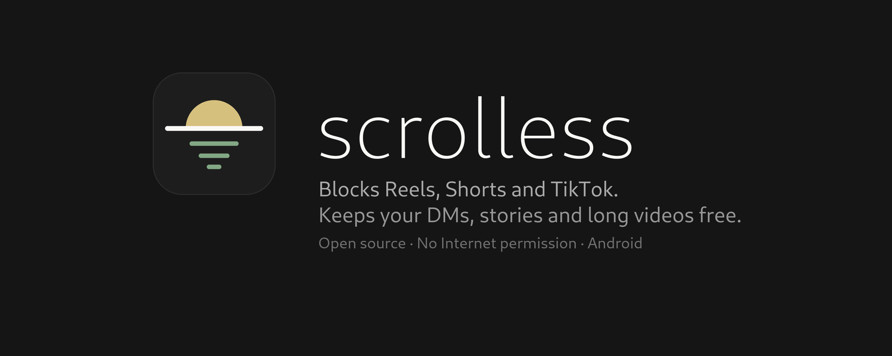
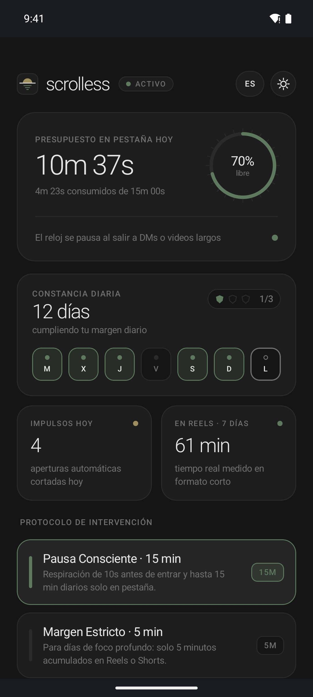
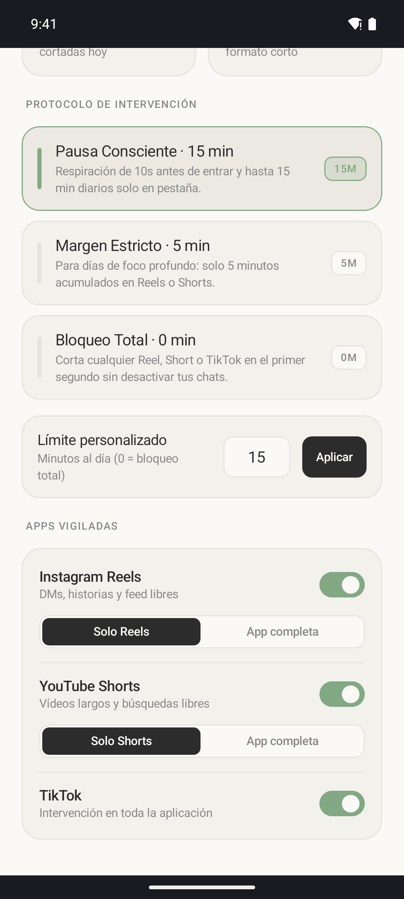
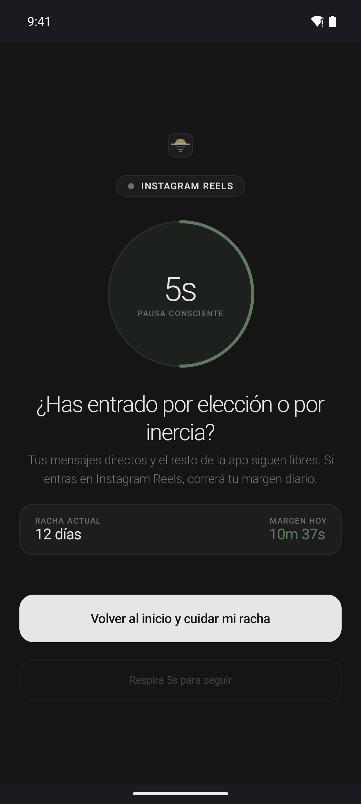

<p align="center"></p>

<p align="center"><strong>English</strong> · <a href="README.es.md">Español</a></p>

# Scrolless

> **Block Reels, Shorts and TikTok on Android without giving up your DMs, stories or long videos.**  
> 100% Open Source · 0 Network Permissions · Reproducible Builds · Minimal Editorial Aesthetic.

<p align="center"></p>

---

## Installation

Scrolless is distributed only through GitHub (no Play Store or F-Droid).

1. **Download the APK** `scrolless-<version>.apk` from [GitHub Releases](../../releases/latest), **or** track this repository with [Obtainium](https://github.com/ImranR98/Obtainium) to get every update automatically.
2. Install it (Android will ask you to allow installing apps from that source). If the **Play Protect** warning "can request access to sensitive data" appears with a single *Got it* button, follow [If Play Protect blocks the installation](#if-play-protect-blocks-the-installation).
3. **Turn on the accessibility service:** Settings → Accessibility → Installed apps (or *Downloaded services*) → **Scrolless** → On.
4. **Android 13 or later:** if the toggle is greyed out ("Restricted setting"), go to Settings → Apps → Scrolless → ⋮ menu (top right) → **Allow restricted settings**, then repeat step 3.

Each release includes its `.sha256` and an SLSA attestation to verify its origin (see below). To publish new versions, see [RELEASING.md](RELEASING.md) (in Spanish).

### If Play Protect blocks the installation

Google Play Protect's **enhanced fraud protection** blocks, with no "install anyway" option, apps downloaded from a browser, a messaging app or a file manager that request the **Accessibility** permission. Scrolless needs it to know whether you are in Reels or Shorts; it does not read text and has no Internet permission (see [verification](#how-to-verify-that-scrolless-is-100-safe-and-matches-this-code)).

You have two ways to install it:

**A. Pause Play Protect during installation** (on the phone)
1. Open **Play Store** → your profile picture → **Play Protect** → ⚙️ (top right) → turn off **Scan apps with Play Protect**.
2. Install `scrolless-<version>.apk`.
3. Turn **Scan apps with Play Protect** back on.

**B. Install with `adb`** (from a computer, with USB or wireless debugging enabled)

```bash
adb install scrolless-<version>.apk
```

Installs through `adb` bypass this block as well as the "restricted setting" one from step 4.

---

## Screenshots

| Dashboard (light) | Dashboard (dark) | Watched apps | Mindful pause |
| :---: | :---: | :---: | :---: |
|  |  |  |  |

*Real emulator screenshots with sample data (a 12-day streak and one week of history).*  
*The screenshots show the Spanish interface; the app also has an English interface.*

---

## Why Scrolless exists

Modern apps mix useful communication channels (Instagram direct messages, long YouTube tutorials) with dopamine traps designed to hold your attention (Reels, Shorts, TikTok).

**Scrolless** does not force you to delete Instagram or YouTube:
1. **Blocks only Reels and Shorts:** It detects when the **Instagram Reels** viewer or the **YouTube Shorts** player fills the screen, leaving your DMs, stories, feed and long videos free. **TikTok** is always treated as a whole app.
2. **"Whole app" toggle:** If you prefer, Instagram and YouTube can be blocked entirely with one tap ("Reels only / Whole app", "Shorts only / Whole app").
3. **In-Tab-Only Time Budget:** With a daily limit (`15 min`, `5 min` or any number of minutes you type), the timer runs **only while Reels/Shorts is on screen** and pauses when you leave.
4. **Mindful Interruption Screen:** When you enter, it asks you to breathe for 10 seconds before continuing; "Go home and keep my streak" takes you to the Android home screen. It does not touch music, calls or other apps' floating windows.
5. **Streaks with Shields (No Frustration):** You add streak days every time you respect your daily limit. Every 7 clean days you earn a **protective shield** so one bad day does not wipe out weeks of consistency. The weekly strip shows your real last 7 days.

---

## How to verify that Scrolless is 100% safe and matches this code

A Reels and Shorts blocker on Android has to use `AccessibilityService` to identify which tab you are in. Because that permission is sensitive, **Scrolless is designed around the "Don't trust, verify" principle**:

### 1. Kernel-Level Zero-Network Guarantee (`Zero-Network Guarantee`)
Scrolless **does not declare `android.permission.INTERNET`** in its [`AndroidManifest.xml`](app/src/main/AndroidManifest.xml).  
On Android, without that permission in the manifest, the Linux kernel prevents the process from opening any TCP/UDP socket. It is **physically impossible** for the app to send data off your device.

You can audit any downloaded APK by running:
```bash
aapt dump permissions scrolless-<version>.apk
# Expected output: only package: com.scrolless.app (0 network permissions)
```

### 2. Reproducible Build (`Reproducible Builds`)
In [`app/build.gradle.kts`](app/build.gradle.kts), the generated archives use `isPreserveFileTimestamps = false` and `isReproducibleFileOrder = true`. If you clone this repository and build with JDK 21 (same as CI), you will get the **same unsigned APK, bit for bit**, that GitHub Actions builds:

```bash
git clone https://github.com/Ivan-olivera-dev/scrolless.git
cd scrolless
git checkout v1.0.0
# Use the same version as the published APK (check it with: aapt2 dump badging scrolless-1.0.0.apk | head -1)
./gradlew assembleRelease -PversionName=1.0.0 -PversionCode=<versionCode of the published APK>
shasum -a 256 app/build/outputs/apk/release/*.apk
```

CI stamps `versionName` from the tag and `versionCode` from the run number, so to compare you have to build with those same values. The APK published in Releases also carries the author's signature, so its hash differs from the unsigned one; its contents (code and resources) are the same and you can compare them with tools such as `diffoscope`.

### 3. Cryptographic Proof of Origin (GitHub SLSA Attestation)
The binaries of each release are built and signed publicly by GitHub Actions ([`android-ci-release.yml`](.github/workflows/android-ci-release.yml)) when a `v*` tag is pushed, together with a cryptographic SLSA attestation:

```bash
gh attestation verify scrolless-<version>.apk --owner <user>
sha256sum -c scrolless-<version>.apk.sha256
```

---

## Design System (Inspired by *Playa del Perelló*)

The interface avoids the visual noise typical of productivity apps and adopts a warm, quiet editorial aesthetic:

| Token | Light Mode | Dark Mode | Use |
| :--- | :--- | :--- | :--- |
| `bgColor` | `#FAF9F6` | `#151515` | Continuous background without heavy cards or shadows |
| `textPrimary` | `#2C2C2C` | `#E6E6E6` | Main typography (`FontWeight.Light` / `Normal`) |
| `textSecondary` | `#8A8A8A` | `#707070` | Subtitles with wide *letter-spacing* |
| `borderColor` | `#EAEAEA` | `#2A2A2A` | `1dp` horizontal dividers |
| `success` | `#82A884` | `#5D7A5E` | Pause Mode + 15m / Healthy use |
| `warning` | `#D6C07E` | `#9E8E5E` | Strict Mode 5m / Caution |
| `danger` | `#C47B7B` | `#8A5757` | Total Block Mode (0m) |

---

## Project Architecture

```text
app/src/main/
├── AndroidManifest.xml                  # Manifest without the INTERNET permission
├── res/xml/accessibility_service_config.xml
└── java/com/scrolless/app/
    ├── core/
    │   ├── DetectionEngine.kt           # Pure rules: visible, tall nodes -> Reels / Shorts / whole app
    │   └── SessionAndStreakManager.kt   # Pure SessionController: timer, passes, streaks and 7-day history
    ├── data/
    │   └── LocalStore.kt                # Local persistence (separate config / runtime, v3 migration)
    ├── service/
    │   └── ScrollessAccessibilityService.kt # Reads only the active window of watched apps
    └── ui/
        ├── PlayaTheme.kt                # Editorial palette and typography
        ├── ScrollessLogo.kt             # "Sun on the horizon" mark
        ├── DashboardScreen.kt           # Main dashboard with metrics and modes
        ├── InterruptionActivity.kt      # Mindful interruption screen
        └── MainActivity.kt              # Entry point
```

### How it detects (without reading any text)

The service only walks nodes **visible to the user** and records their `resource-id`, whether they are selected and what fraction of the screen they cover. It never captures text or descriptions.

| App | Treated as short-form when… | Never blocked |
| :--- | :--- | :--- |
| Instagram | `clips_viewer_view_pager` covers >= 60% of the height **and** (`clips_single_media_component` does too, **or** the `clips_tab` tab is selected) | Stories (`reel_viewer_*`), DM inbox and threads |
| YouTube | `reel_watch_player`, `reel_player_page_container` or `reel_recycler` covers >= 60% of the height | Home (small Shorts shelf), long videos |
| TikTok | Always (whole app) | — |

---

## Contributing new View IDs

When Instagram or YouTube update their interface they may rename their identifiers. Debug builds log every evaluation to logcat, with identifiers and sizes only:

```bash
./gradlew installDebug
adb logcat -s ScrollessDiag
# pkg=com.instagram.android signal=ig-reels:media decision=interrupt ... nodes=[clips_viewer_view_pager(1.00),clips_single_media_component(1.00),clips_tab(0.06,sel)]
```

1. Turn on Scrolless in Accessibility and navigate to the screen that fails.
2. Copy the matching `ScrollessDiag` line (it contains no text or personal data).
3. Adjust the rule in `DetectionEngine.kt`, add the case to `DetectionEngineTest.kt` and send a Pull Request.

If an app changes too much, the **"Whole app"** toggle keeps working without depending on its IDs.

---

## Brand

"Sun on the horizon" logo (an ochre sun over a horizon line, with its reflection in sage) on obsidian. Files in [`docs/brand/`](docs/brand):

| File | Use |
| :--- | :--- |
| `scrolless-icon-1024.png` / `-512.png` | Square icon (avatar, portfolio) |
| `scrolless-mark-on-dark.png` / `-on-light.png` | Mark on a transparent background |
| `scrolless-banner.png` | 1600×640 header in English (README, social media) |
| `scrolless-banner-es.png` | 1600×640 header in Spanish (Spanish README) |
| `scrolless-showcase.png` | Composition with three real screens |

---

## License

Distributed under the [MIT](LICENSE) license.
