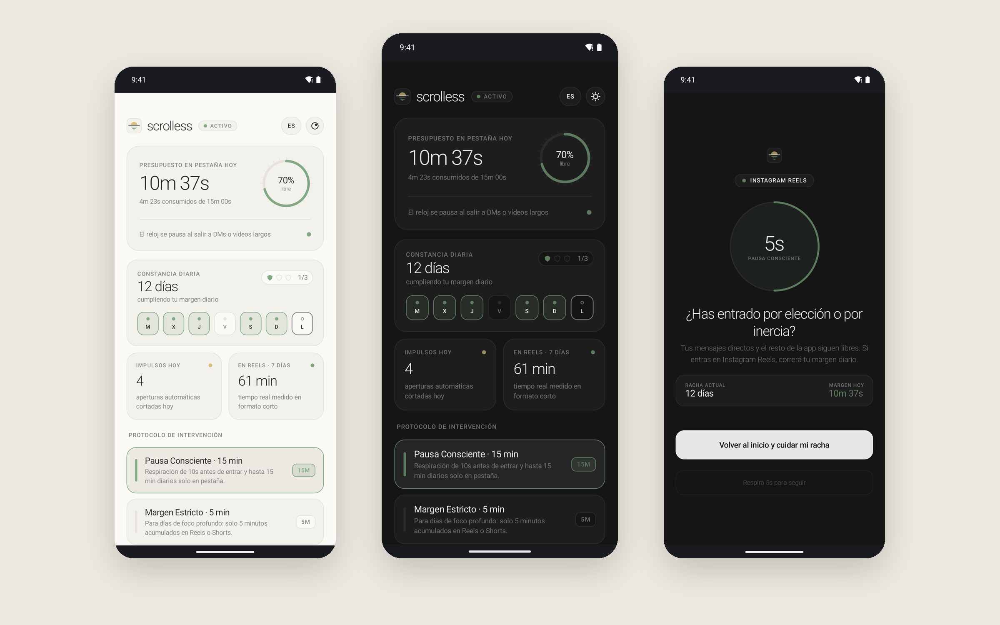
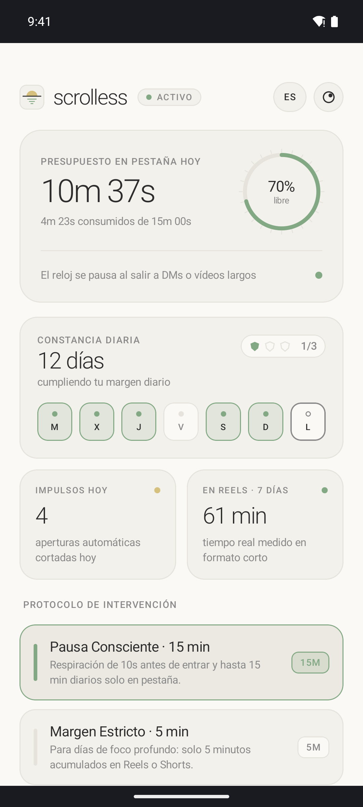

<p align="center"></p>

# Scrolless

> **Bloquea Reels, Shorts y TikTok en Android sin renunciar a tus DMs, historias ni vídeos largos.**  
> 100% Open Source · 0 Permisos de Red · Builds Reproducibles · Estética Minimalista Editorial.

<p align="center"></p>

---

## Instalación

Scrolless se distribuye solo por GitHub (sin Play Store ni F-Droid).

1. **Descarga el APK** `scrolless-<versión>.apk` desde [GitHub Releases](../../releases/latest), **o** sigue este repositorio con [Obtainium](https://github.com/ImranR98/Obtainium) para recibir cada actualización automáticamente.
2. Instálalo (Android te pedirá permitir instalar apps de esa fuente).
3. **Activa el servicio de accesibilidad:** Ajustes → Accesibilidad → Apps instaladas (o *Servicios descargados*) → **Scrolless** → Activar.
4. **Android 13 o superior:** si el interruptor aparece gris ("Ajuste restringido"), ve a Ajustes → Apps → Scrolless → menú ⋮ (arriba a la derecha) → **Permitir ajustes restringidos**, y repite el paso 3.

Cada release incluye su `.sha256` y una atestación SLSA para verificar el origen (ver más abajo). Para publicar versiones nuevas, ver [RELEASING.md](RELEASING.md).

---

## Capturas

| Panel (claro) | Panel (oscuro) | Apps vigiladas | Pausa consciente |
| :---: | :---: | :---: | :---: |
|  |  |  |  |

*Capturas reales del emulador con datos de ejemplo (racha de 12 días y una semana de historial).*

---

## Por qué existe Scrolless

Las aplicaciones modernas mezclan canales de comunicación útiles (mensajes directos de Instagram, tutoriales largos de YouTube) con trampas de dopamina diseñadas para retener tu atención (Reels, Shorts, TikTok).

**Scrolless** no te obliga a borrar Instagram ni YouTube:
1. **Bloqueo solo de Reels y Shorts:** Detecta cuando el visor de **Instagram Reels** o el reproductor de **YouTube Shorts** ocupa la pantalla, dejando libres tus DMs, historias, el feed y los vídeos largos. **TikTok** se trata siempre como app completa.
2. **Interruptor "App completa":** Si prefieres, Instagram y YouTube se pueden bloquear enteros con un toque ("Solo Reels / App completa", "Solo Shorts / App completa").
3. **Presupuesto de Tiempo Solo en Pestaña:** Con un límite diario (`15 min`, `5 min` o los minutos que escribas), el cronómetro corre **únicamente mientras Reels/Shorts está en pantalla** y se pausa al salir.
4. **Pantalla de Interrupción Consciente:** Al entrar te propone respirar 10 segundos antes de seguir; "Volver al inicio" te lleva al escritorio de Android. Sin tocar la música, las llamadas ni las ventanas flotantes de otras apps.
5. **Rachas con Escudos (Sin Frustración):** Suma días de racha cada vez que respetas tu límite diario. Cada 7 días limpios ganas un **escudo protector** para que un mal día puntual no destruya semanas de constancia. La tira semanal muestra tus 7 días reales.

---

## Cómo verificar que Scrolless es 100% seguro y fiel a este código

Un bloqueador de Reels y Shorts en Android requiere usar `AccessibilityService` para identificar en qué pestaña estás. Como ese permiso es sensible, **Scrolless está diseñado bajo el principio de "No confíes, verifica" (*Don't trust, verify*)**:

### 1. Garantía Cero-Red a nivel Kernel (`Zero-Network Guarantee`)
Scrolless **no declara `android.permission.INTERNET`** en su [`AndroidManifest.xml`](app/src/main/AndroidManifest.xml).  
En Android, sin ese permiso en el manifiesto, el kernel de Linux prohíbe al proceso abrir cualquier socket TCP/UDP. Es **físicamente imposible** que la app envíe datos fuera de tu dispositivo.

Puedes auditar cualquier APK descargado ejecutando:
```bash
aapt dump permissions scrolless-<versión>.apk
# Salida esperada: únicamente package: com.scrolless.app (0 permisos de red)
```

### 2. Compilación Reproducible (`Reproducible Builds`)
En [`app/build.gradle.kts`](app/build.gradle.kts), los archivos generados tienen `isPreserveFileTimestamps = false` e `isReproducibleFileOrder = true`. Si clonas este repositorio y compilas con JDK 21 (igual que la CI), obtendrás el **mismo APK sin firmar, bit por bit**, que construye GitHub Actions:

```bash
git clone https://github.com/Ivan-olivera-dev/scrolless.git
cd scrolless
git checkout v1.0.0
# Usa la misma versión que el APK publicado (mírala con: aapt2 dump badging scrolless-1.0.0.apk | head -1)
./gradlew assembleRelease -PversionName=1.0.0 -PversionCode=<versionCode del APK publicado>
shasum -a 256 app/build/outputs/apk/release/*.apk
```

La CI estampa `versionName` desde la etiqueta y `versionCode` desde el número de ejecución, así que para comparar hay que compilar con esos mismos valores. El APK publicado en Releases además lleva la firma del autor, así que su hash difiere del sin firmar; su contenido (código y recursos) es el mismo y puedes compararlo con herramientas como `diffoscope`.

### 3. Prueba Criptográfica de Origen (GitHub SLSA Attestation)
Los binarios de cada release los compila y firma públicamente GitHub Actions ([`android-ci-release.yml`](.github/workflows/android-ci-release.yml)) al empujar una etiqueta `v*`, junto con una atestación criptográfica SLSA:

```bash
gh attestation verify scrolless-<versión>.apk --owner <usuario>
sha256sum -c scrolless-<versión>.apk.sha256
```

---

## Sistema de Diseño (Inspirado en *Playa del Perelló*)

La interfaz evita el ruido visual típico de las apps de productividad y adopta una estética editorial cálida y silenciosa:

| Token | Modo Claro | Modo Oscuro | Uso |
| :--- | :--- | :--- | :--- |
| `bgColor` | `#FAF9F6` | `#151515` | Fondo continuo sin tarjetas pesadas ni sombras |
| `textPrimary` | `#2C2C2C` | `#E6E6E6` | Tipografía principal (`FontWeight.Light` / `Normal`) |
| `textSecondary` | `#8A8A8A` | `#707070` | Subtítulos con *letter-spacing* amplio |
| `borderColor` | `#EAEAEA` | `#2A2A2A` | Divisores horizontales de `1dp` |
| `success` | `#82A884` | `#5D7A5E` | Modo Pausa + 15m / Uso saludable |
| `warning` | `#D6C07E` | `#9E8E5E` | Modo Estricto 5m / Precaución |
| `danger` | `#C47B7B` | `#8A5757` | Modo Bloqueo Total (0m) |

---

## Arquitectura del Proyecto

```text
app/src/main/
├── AndroidManifest.xml                  # Manifiesto sin permiso INTERNET
├── res/xml/accessibility_service_config.xml
└── java/com/scrolless/app/
    ├── core/
    │   ├── DetectionEngine.kt           # Reglas puras: nodos visibles y altos -> Reels / Shorts / app completa
    │   └── SessionAndStreakManager.kt   # SessionController puro: timer, pases, rachas e historial de 7 días
    ├── data/
    │   └── LocalStore.kt                # Persistencia local (config / runtime separados, migración v3)
    ├── service/
    │   └── ScrollessAccessibilityService.kt # Lee solo la ventana activa de las apps vigiladas
    └── ui/
        ├── PlayaTheme.kt                # Paleta y tipografía editorial
        ├── ScrollessLogo.kt             # Marca "sol en el horizonte"
        ├── DashboardScreen.kt           # Panel principal de métricas y modos
        ├── InterruptionActivity.kt      # Pantalla de interrupción consciente
        └── MainActivity.kt              # Punto de entrada
```

### Cómo detecta (sin leer ningún texto)

El servicio solo recorre nodos **visibles para el usuario** y guarda su `resource-id`, si están seleccionados y qué fracción de la pantalla ocupan. Nunca captura textos ni descripciones.

| App | Se considera formato corto cuando… | Nunca se bloquea |
| :--- | :--- | :--- |
| Instagram | `clips_viewer_view_pager` ocupa >= 60% de la altura **y** (`clips_single_media_component` también, **o** la pestaña `clips_tab` está seleccionada) | Historias (`reel_viewer_*`), bandeja e hilos de DMs |
| YouTube | `reel_watch_player`, `reel_player_page_container` o `reel_recycler` ocupa >= 60% de la altura | Inicio (estante pequeño de Shorts), vídeos largos |
| TikTok | Siempre (app completa) | — |

---

## Contribuir nuevos View IDs

Cuando Instagram o YouTube actualizan su interfaz pueden renombrar sus identificadores. Las builds de depuración registran cada evaluación en logcat, solo con identificadores y tamaños:

```bash
./gradlew installDebug
adb logcat -s ScrollessDiag
# pkg=com.instagram.android signal=ig-reels:media decision=interrupt ... nodes=[clips_viewer_view_pager(1.00),clips_single_media_component(1.00),clips_tab(0.06,sel)]
```

1. Activa Scrolless en Accesibilidad y navega por la pantalla que falla.
2. Copia la línea `ScrollessDiag` correspondiente (no contiene textos ni datos personales).
3. Ajusta la regla en `DetectionEngine.kt`, añade el caso a `DetectionEngineTest.kt` y envía un Pull Request.

Si una app cambia demasiado, el interruptor **"App completa"** sigue funcionando sin depender de sus IDs.

---

## Marca

Logo "sol en el horizonte" (sol ocre sobre una línea de horizonte, con su reflejo en salvia) sobre obsidiana. Archivos en [`docs/brand/`](docs/brand):

| Archivo | Uso |
| :--- | :--- |
| `scrolless-icon-1024.png` / `-512.png` | Icono cuadrado (avatar, portfolio) |
| `scrolless-mark-on-dark.png` / `-on-light.png` | Marca con fondo transparente |
| `scrolless-banner.png` | Cabecera 1600×640 (README, redes) |
| `scrolless-showcase.png` | Composición con tres pantallas reales |

---

## Licencia

Distribuido bajo la licencia [MIT](LICENSE).
